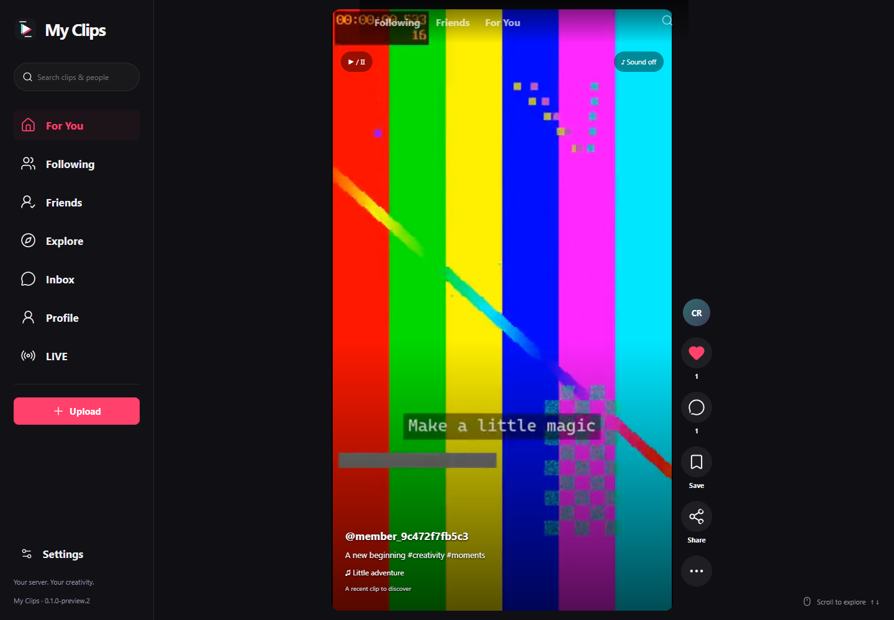

# My Clips

Your creativity. Your server.

My Clips is an original TikTok-style short-video app for One Workspace, with a
standalone Windows executable, installable PWA and signed Android client.
Apache-2.0 application code; Kenney CC0 default sounds.



## Watch and create

- Vertical swipe feed, For You, Following and Friends; likes, comments, saves,
  search, creator profiles, private accounts, follow requests, block and report.
- Camera recording, pause/resume, multiple clips, trim, reorder, speed, flip,
  colour filters including glow, timed text/emoji and voiceover.
- Six CC0 default sounds, your audio files and browser-authorized My Music
  library selection, with soundtrack trim and mix levels.
- Render preview, private device drafts, audience selection, scheduling,
  opt-in Duet/Stitch and a creator studio.
- Mutual-follow messages, activity inbox, SSE updates, browser Web Push and
  Android's optional periodic activity notifications.
- Small WebRTC live rooms, up to eight viewers, with operator-configurable TURN.
- Transparent watch/skip/follow/hashtag recommendations and a reset control.

Original files are preserved byte-for-byte in the private **My Clips Originals**
Drive source. Only each account's own physical scope is exposed in Drive.
Audience-checked derivatives use 360p/540p/720p HLS, measured segment bandwidth,
bounded buffers and MP4 byte-range fallback. Nothing is uploaded to TikTok or
Google Drive; “Drive” here is the ecosystem's native My Drive.

## Install

Download [the release](https://github.com/oneworkspacestudio/my-clips/releases).
For integrated sign-in, My Drive and My Music, install
[One Workspace 0.3.0-preview.53 or later](https://github.com/oneworkspacestudio/one-workspace/releases).
Open **My Clips** in the app picker, or `/clips/`.

Standalone Windows:

```powershell
.\MyClips.exe --data C:\MyClips\Private --listen 127.0.0.1:9014 --origin http://localhost:9014
```

Use the first-run owner setup link displayed by the app. Store private data on
NTFS. For access from phones, use a trusted HTTPS endpoint. Do not expose a
loopback development server directly to the internet. Default standalone
originals live below the private data directory, without native Drive integration.

Video processing automatically downloads the pinned, hash-verified FFmpeg and
FFprobe helper archive on supported Windows hosts. You can instead set
`MYCLIPS_FFMPEG` and `MYCLIPS_FFPROBE` to your installed executables.
`MYCLIPS_AUTO_HELPERS=false` disables automatic helper acquisition.
Helpers are separately obtained upstream software, not included in the app ZIP.

On Android 9 or later, install `MyClips-0.1.0-preview.2.apk` and enter your
Workspace HTTPS address. The native client supplies camera/microphone permission
handling, system file selection and optional private activity notifications.
Browser/PWA and Android use the same server account and videos.

## Preview boundaries

This is a working first preview, **not full TikTok feature parity**. No TikTok
code, trademarks, private ranking model, commercial music rights, ads, Shop,
coins/gifts, AR face tracking, automatic captions or internet-scale live service
is included. The creation editor is a connected single-page flow.
See [features and limits](docs/FEATURES.md), [acceptance](docs/ACCEPTANCE.md),
[base selection](docs/BASE-SELECTION.md) and [security](SECURITY.md).

## Build

Go 1.27.2, Node 26 and Python 3 are used by the Windows build. UI screen trees
are authored in `web/src/screens/*.aui` and deterministically generated.

```powershell
npm --prefix web ci
.\scripts\build.ps1 -Go go
```

Run `go test ./...` and `go vet ./...`. `scripts/browser-verify.mjs` exercises
the real packaged server, Chrome, FFmpeg, HLS, access control, capture and live
video with synthetic accounts. Its test paths are configurable in the script.
`scripts/managed-verify.mjs` verifies a fresh native Workspace installation.
Neither harness may point at an existing user's installation.

Android builds use SDK platform 35, build tools 36 and JDK 21:
set `MYCLIPS_SIGNING_PASSWORD` in the build process environment, then run
`scripts/build-android.ps1 -KeyStore <your-release-key.jks>`.
Keep the signing key to issue compatible updates. No signing secrets are included.
