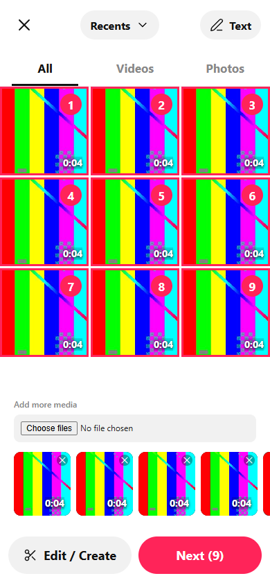
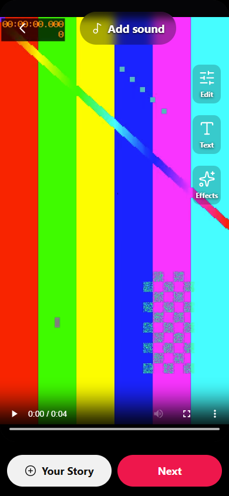
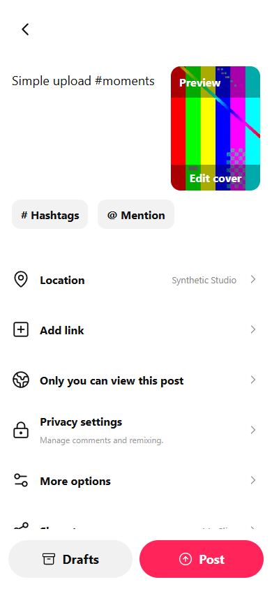

# Simple upload flow (preview5)

1. Upload opens Recents. Choose videos or photos from the device picker. The
   three-column grid shows local thumbnails, durations and selection order.
   All / Videos / Photos filters and the selected-media strip control the selection.
2. Next opens a full-screen preview. Next continues directly to post details.
   Edit / Create, Edit, Text, Effects and Add sound open the complete video editor.
   Done returns to preview. Your Story chooses an expiring story instead.
3. Add a description and optionally hashtags, mentions, location, a link in the
   description, a cover frame, audience, comments/remix settings, accessibility
   text or a schedule. Drafts saves a private account-scoped device draft. Post
   uploads originals and automatically prepares streaming video before publishing.

Back preserves selected files and settings. Failed uploads keep completed media;
failed publication retries reuse the prepared output and idempotency key.
Privacy settings and publication commit together. Video preparation still takes
time but is part of Post; it is never a prerequisite button in the simple flow.
Optional Preview edits prepares an exact preview from inside the editor.

The browser can list only files the user has selected; Recents is not unrestricted
access to the device camera roll. Photo and video selections are separate posts.
Photos post directly as a carousel. Videos retain their original duration until
explicitly trimmed; the existing final-video limit is three minutes. AutoCut,
commercial sound catalogues, device location suggestions and cross-platform
auto-posting are not provided. Share uses My Clips and the device share menu.
Text creation starts in the editor and requires an uploaded or recorded video.

## Verification

`scripts/upload-verify.mjs` launches an isolated native Windows app, creates only
synthetic media and runs the new flow checks. Set `MYCLIPS_FULL_TESTS=1` to include
the existing edited-video/HLS/audience/camera/live regression with the new flow.
All fixture data stays in the named NTFS cache; originals use an isolated adapter.
Run the Go suite and vet plus `npm --prefix web run build` as well.

Visual captures use synthetic patterns, not the user's reference photos:

